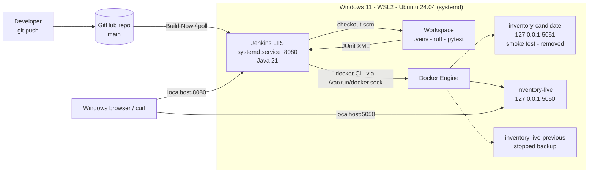

# Inventory API - Jenkins CI/CD on Ubuntu WSL2

A small Flask inventory API delivered through a declarative Jenkins pipeline.
Jenkins is installed **natively as a systemd service** inside Ubuntu 24.04 on WSL2.
Every push to `main` is linted, unit-tested, containerised, smoke-tested and only then deployed
locally, with automatic rollback if the new release fails post-deployment validation.

## Architecture



```
Developer -> GitHub (main) -> Jenkins (WSL2, :8080)
   Checkout -> Setup venv -> Lint (ruff) -> Unit tests (pytest + JUnit)
   -> docker build inventory-api:<BUILD_NUMBER>
   -> smoke test container on 127.0.0.1:5051 (functional + security checks)
   -> [bonus] runtime lock / scan report
   -> deploy.sh: keep old container as backup, start new on 127.0.0.1:5050,
      validate /health -> success: keep | failure: restore previous + fail build
```

## Repository structure

| Path | Purpose |
|---|---|
| `app/main.py` | Flask API (single in-memory `ITEMS` dataset) |
| `tests/test_api.py` | 18 pytest cases (starter + low-stock + error handling) |
| `Dockerfile` | Runtime-only image, Gunicorn, non-root UID 10001, HEALTHCHECK |
| `.dockerignore` | Excludes `.git`, `.venv`, tests, CI files, secrets (`.env`, `*.pem`, `*.key`) |
| `Jenkinsfile` | Declarative pipeline (pipeline-as-code) |
| `scripts/deploy.sh` | Deploy with post-deployment validation and automatic rollback |
| `scripts/test-rollback.sh` | Reproducible failure-recovery test |
| `requirements.txt` | Runtime deps (Flask, Gunicorn) - the only file installed in the image |
| `requirements-dev.txt` | Runtime + pytest + ruff - used by CI/local only |

## Setup

Prerequisites: Ubuntu 24.04 on WSL2 with systemd, Python 3 + `python3-venv`, Git, Jenkins LTS (Java 21),
Docker (Docker Desktop WSL integration **or** native Docker Engine - not both).
Keep the clone in the Linux filesystem (`~/projects`), not under `/mnt/c`.

```bash
git clone https://github.com/<your-user>/<your-repo>.git && cd <your-repo>
python3 -m venv .venv
.venv/bin/pip install -r requirements-dev.txt
```

## Endpoints

| Method | Path | Success | Errors |
|---|---|---|---|
| GET | `/` | `200` `{"service","version","status":"running"}` | - |
| GET | `/health` | `200` `{"status":"ok"}` | - |
| GET | `/api/items` | `200` `{"items":[...]}` | - |
| GET | `/api/items/<id>` | `200` item object | `404` `{"error":"item not found"}` |
| GET | `/api/items/low-stock?threshold=N` | `200` `{"threshold":N,"items":[...]}` - items with `stock < N` (strictly below) | `400` JSON error |

Examples:

```bash
curl -i "http://127.0.0.1:5050/api/items/low-stock?threshold=5"   # 200, returns switch (stock 3)
curl -i "http://127.0.0.1:5050/api/items/low-stock?threshold=8"   # 200, router (stock 8) NOT included
curl -i "http://127.0.0.1:5050/api/items/low-stock?threshold=abc" # 400 {"error":"threshold must be an integer"}
```

## Error handling

| Situation | Status | Body |
|---|---|---|
| `threshold` missing or blank | 400 | `{"error":"threshold query parameter is required"}` |
| `threshold` not an integer (`abc`, `5.5`, `1e2`) | 400 | `{"error":"threshold must be an integer"}` |
| `threshold` < 0 or > 100 | 400 | `{"error":"threshold must be between 0 and 100"}` |
| Unknown item id | 404 | `{"error":"item not found"}` |
| Unknown route | 404 | `{"error":"not found"}` |
| Wrong HTTP method | 405 | `{"error":"method not allowed"}` |

All errors are JSON, so clients never have to parse HTML error pages.

## Testing

```bash
.venv/bin/ruff check app tests
.venv/bin/python -m pytest -v
```

The low-stock tests compute the expected result from the `ITEMS` dataset (nothing hard-coded) and cover:
filtered results, the strict `<` boundary (stock == threshold is excluded), range boundaries 0 and 100,
invalid input (`-1`, `101`, `abc`, `5.5`, `1e2`, empty, blank), missing parameter, route co-existence
with `/api/items/<id>`, and JSON 404s.

**Fresh-clone reproducibility** (only declared requirements are used):

```bash
rm -rf /tmp/fresh && git clone https://github.com/<your-user>/<your-repo>.git /tmp/fresh && cd /tmp/fresh
python3 -m venv .venv && .venv/bin/pip install -r requirements-dev.txt && .venv/bin/python -m pytest -q
```

## Pipeline sequence

| # | Stage | What it proves | On failure |
|---|---|---|---|
| 1 | Checkout | Exact commit (`git rev-parse --short HEAD`) | stop |
| 2 | Setup | venv from declared requirements only | stop |
| 3 | Lint | `ruff check app tests` | stop - nothing built |
| 4 | Unit tests | pytest, JUnit published to Jenkins | stop - no image, no deploy |
| 5 | Build image | `inventory-api:<BUILD_NUMBER>` | stop |
| 6 | Container smoke test | Candidate on :5051 - health, items, 404, low-stock 200/400, **uid != 0**, **no pytest/ruff in image**, no leaked build context | stop - live untouched |
| 7 | Image report (bonus) | `pip freeze` runtime lock + optional Trivy scan, archived | stop |
| 8 | Deploy locally | `scripts/deploy.sh` with validation and rollback | build FAILED, previous version restored |

## Deployment and rollback (Challenge 3, option a)

`scripts/deploy.sh <image:tag>`:

1. Removes the old backup, then **stops** `inventory-live` and renames it to `inventory-live-previous` (kept, not deleted).
2. Starts the new image as `inventory-live` on `127.0.0.1:5050`.
3. Validates for up to 20 s: `/health` must return `{"status":"ok"}` and `/api/items` must answer.
4. **Pass** - new version stays live; the previous container is kept stopped for manual rollback.
   **Fail** - prints the new container's logs, removes it, renames/starts the previous container,
   re-validates it, and exits `1` so Jenkins marks the build as failed.

**Manual rollback** to any earlier build (images are tagged with the Jenkins build number):

```bash
docker images inventory-api                    # pick a known-good tag
bash scripts/deploy.sh inventory-api:<good-build-number>
```

**Recovery test:** `bash scripts/test-rollback.sh` builds a deliberately broken image (process exits immediately)
from the live image, deploys it, and asserts that the previous image is restored and healthy.

**What clients see during cutover:** the service runs as a single container on one port, so there is a short
outage window. `docker stop -t 10` sends SIGTERM; Gunicorn stops accepting new connections and lets in-flight
requests finish (up to 10 s, then SIGKILL). From that point until the new container passes `/health`
(typically 1-3 s), new connections to `:5050` are **refused**; clients must retry. A rollback adds a second,
similar gap. Zero-downtime would require blue/green (option b): two containers on different ports behind a
reverse proxy (e.g. Nginx) and an atomic upstream switch + `nginx -s reload`.

## Security notes (Challenge 4)

- Application runs as non-root UID `10001` (`USER 10001`); code files are root-owned and read-only to the app.
- Image installs **only** `requirements.txt`; the smoke test fails the build if `pytest` or `ruff` is importable.
- `.dockerignore` keeps `.git`, `.venv`, tests, CI files and secrets (`.env*`, `*.pem`, `*.key`) out of the build context.
- Ports are bound to `127.0.0.1` only - not exposed to the LAN.
- No tokens or passwords in the repo or Jenkinsfile. A private repo uses a Jenkins credential (PAT) selected in the job configuration.

### Docker socket risk and safer alternative

Adding `jenkins` to the `docker` group gives every pipeline full access to `/var/run/docker.sock`, which is
**root-equivalent** on the host: any job (or a malicious commit to a Jenkinsfile) can run
`docker run -v /:/host --privileged ...` and read or modify the entire host, including Jenkins secrets.
This is acceptable only in an isolated personal lab.

Safer production alternative: keep the Jenkins controller free of Docker access and run builds on
**separate, ephemeral build agents** (e.g. a Kubernetes or cloud agent created per build and destroyed afterwards),
building images with a **daemonless/rootless builder** such as Kaniko, Buildah or rootless BuildKit, and
deploying through a gated, credential-scoped deployment step.

## Bonus (stretch) work

- **Multibranch / PR flow:** create a *Multibranch Pipeline* job pointing at the same repo. The `Deploy locally`
  stage only runs when `BRANCH_NAME == 'main'`; feature branches and PRs stop after the smoke test.
- **Dependency lock / scan:** stage `Image report (bonus)` archives `reports/runtime-lock.txt` (exact runtime
  package versions from the built image) and `reports/trivy.txt` (HIGH/CRITICAL findings if Trivy is installed).

## Troubleshooting

- Port 8080 in use: `sudo systemctl edit jenkins` -> `[Service]` `Environment="JENKINS_PORT=8081"`.
- Port 5050/5051 in use: `docker ps`, `ss -tlnp`, remove old lab containers.
- `permission denied ... docker.sock`: daemon running? `id jenkins` shows `docker`? `sudo systemctl restart jenkins`.
- `python3 -m venv` fails: `sudo apt install -y python3-venv`.
- Smoke test fails: `docker logs inventory-candidate`, check port mapping and `/health`.
- `bash\r: No such file or directory`: CRLF line endings - `.gitattributes` forces LF; re-clone inside WSL.
